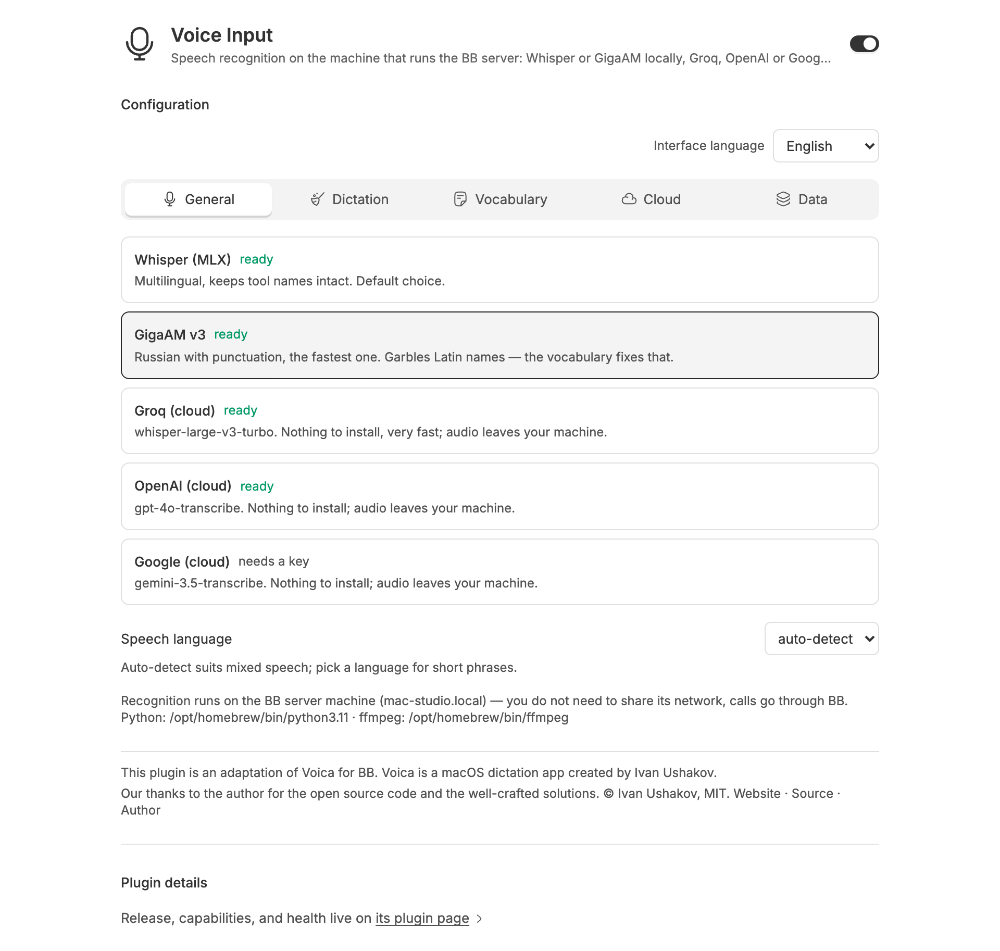
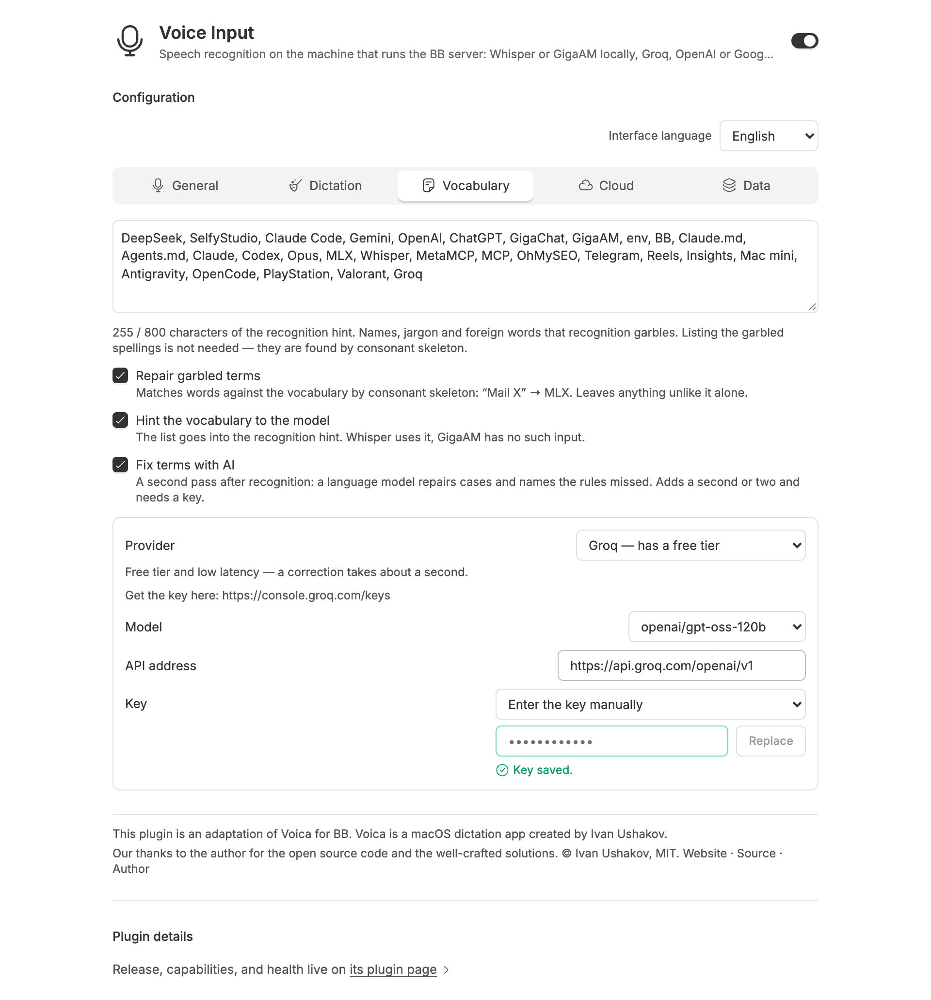
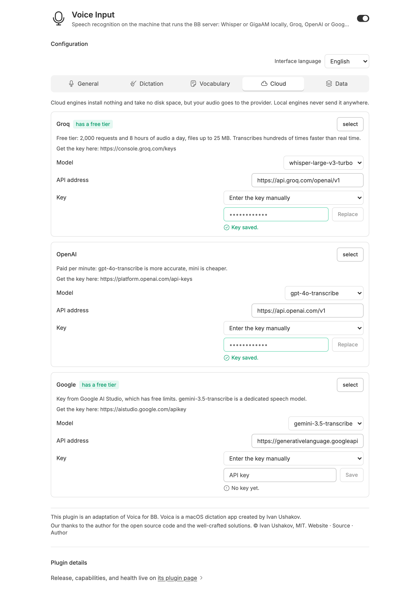
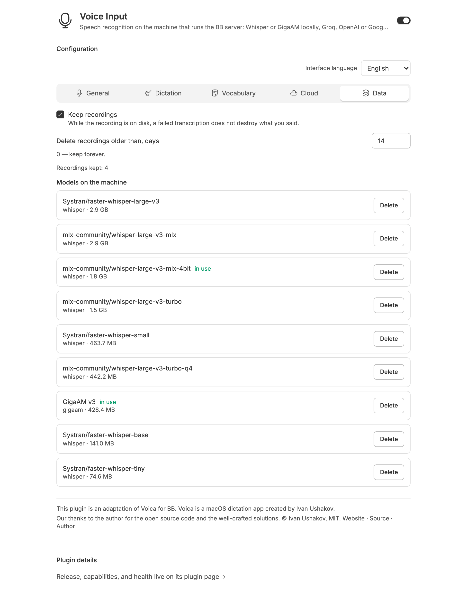

# BB Voice Input

BB Voice Input adds speech transcription to BB chat. It can run Whisper or GigaAM on a recognition host, or send audio to Groq, OpenAI, or Google. Transcripts can be cleaned, matched against a vocabulary, and inserted into the original composer draft.

## Quick start

```sh
bb plugin install .
bb settings ai-services set voice local-voice
bb voice-input setup
bb voice-input status
```

Local engines need Python 3 and `ffmpeg` on the recognition host. Cloud engines need a provider key. See [Deployment](docs/deployment.md) for the full setup.

## Interface language

Settings, recording controls, notifications and plugin error messages support English, Russian, Portuguese, Spanish, German, French, Chinese and Japanese. New installations follow the BB interface language; choose **Same as BB** or an explicit language in the plugin settings. Existing language choices are preserved. Speech language is a separate setting.

Regional interface codes such as `pt-BR` and `ru-RU` use the matching translation; unsupported languages use English. The recording language travels with its request, without changing the saved configuration. Technical diagnostics returned by third-party services may remain in their original language.

Thanks to [@masalles](https://github.com/masalles) for the missing-key and recording-interface translations in [PR #1](https://github.com/VKirill/bb-plugin-voice-input/pull/1) and [PR #2](https://github.com/VKirill/bb-plugin-voice-input/pull/2).

To verify translations and the built recognition host:

```sh
npm test
npm run typecheck
npm run build
npm run test:host
```

## Documentation

- [Project overview](docs/overview.md)
- [Architecture](docs/architecture.md)
- [Dictation](docs/features/dictation.md)
- [Transcription and text processing](docs/features/transcription.md)
- [Settings and engine management](docs/features/settings-and-engine-management.md)
- [Plugin API and commands](docs/api.md)
- [Data model](docs/data-model.md)
- [Deployment](docs/deployment.md)
- [Gotchas](docs/gotchas.md)
- [Decisions](docs/decisions.md)
- [Agent project facts](PROJECT.md)

## Screenshots

| Engines and speech language | Vocabulary and AI correction |
| --- | --- |
|  |  |
| Cloud providers and API keys | Recordings and disk models |
|  |  |

## Credits and license

Adapted from [Voica](https://voica.ru/), created by Ivan Ushakov. The vocabulary repair algorithm, AI correction prompts, and text cleanup heuristics originate from Voica ([source](https://github.com/Inhum/voica)). This project is licensed under MIT; see [LICENSE](LICENSE).
