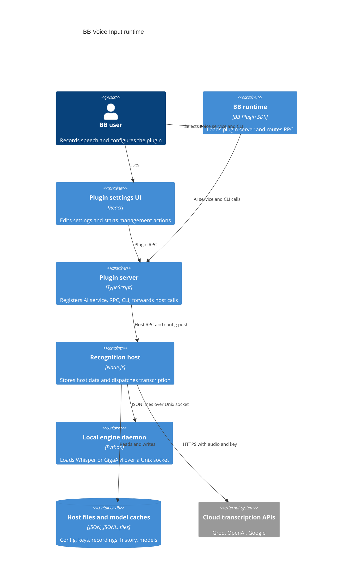

# Architecture

TL;DR: The plugin server registers BB-facing RPC, CLI, and AI-service interfaces; the React settings page uses plugin RPC; the selected host handles transcription and local model processes (`server.ts:353-558`, `host.ts:432-629`).

## System Context

BB routes voice-service requests and plugin-page calls into the plugin. The plugin server forwards configuration and host RPC to the selected recognition machine; that host calls cloud APIs or local Python engines (`server.ts:172-175`, `server.ts:238-255`, `host.ts:278-351`).

## Containers

The UI is the plugin settings app registered from `package.json`; BB invokes the plugin server and host entries separately (`package.json:6-27`). The host contract combines management methods with the SDK AI-services host contract (`src/host-contract.ts:1-10`). Local Python source is embedded during build and materialized by the host (`scripts/embed-assets.mjs:1-29`, `host.ts:574-576`).

## Building Blocks

- **Plugin server** — `server.ts` registers the page RPC handlers, host client, AI service, and CLI commands (`server.ts:172-175`, `server.ts:353-591`).
- **Recognition host** — `host.ts` implements the management contract and `ai.voice.transcribe` path (`host.ts:432-557`).
- **Contracts and settings** — `src/contract.ts` defines engine IDs, shared configuration, and host RPC methods; `src/settings-store.ts` owns persisted settings validation and defaults (`src/contract.ts:8-210`, `src/settings-store.ts:20-103`).
- **Browser dictation** — `src/frontend/` detects triggers, keeps recording state at page scope, and inserts text into BB drafts (`src/frontend/voice-interceptor.ts:23-49`, `src/frontend/global-voice-session.ts:105-164`, `src/frontend/composer-insert.ts:1-5`).
- **Local engines** — `python/voiced.py` serves JSON requests over a Unix socket; `python/engines.py` implements Whisper and GigaAM (`python/voiced.py:1-9`, `python/engines.py:22-35`, `python/engines.py:225`).
- **Cloud engines** — `src/cloud.ts` calls OpenAI-compatible transcription APIs and Google Gemini APIs (`src/cloud.ts:57-90`, `src/cloud.ts:99-154`).

## Key Flows

### Browser recording to BB draft

1. `src/frontend/voice-interceptor.ts` identifies a composer microphone or configured hotkey and starts the singleton session (`src/frontend/voice-interceptor.ts:234-249`, `src/frontend/voice-interceptor.ts:304-315`).
2. `src/frontend/global-voice-session.ts` requests microphone permission, records chunks, then encodes the completed blob as base64 (`src/frontend/global-voice-session.ts:212-260`, `src/frontend/global-voice-session.ts:338-418`).
3. The session calls the configured transcribe function or the plugin RPC route; the server forwards audio to `transcribeDirect` on the selected host (`src/frontend/global-voice-session.ts:390-418`, `server.ts:514-531`).
4. The host transcribes and returns text; the browser inserts it at the live or remembered caret and updates the BB draft in localStorage (`host.ts:554-566`, `src/frontend/global-voice-session.ts:511-565`).

### Host transcription

1. The host loads its config and secret values, decodes audio, and persists a recording when configured (`host.ts:127-140`, `host.ts:387-411`).
2. `runTranscription` selects a cloud API call or starts the local daemon (`host.ts:265-351`).
3. The host repairs vocabulary terms, cleans text, optionally runs the AI pass, appends history, and prunes old recording-day directories (`host.ts:192-229`, `host.ts:353-384`).
4. The result returns through host RPC to the plugin server and browser (`host.ts:554-566`, `server.ts:514-531`).

## Invariants

- API-key values are removed from server-pushed config and resolved from the host secret file or host environment (`server.ts:194-230`, `host.ts:127-140`).
- Only the selected local engine daemon remains active after config changes; changing engine or Whisper model stops stale local daemons (`host.ts:465-481`).
- One local Python daemon serializes inference behind a lock because the loaded models are not treated as safe for parallel runs (`python/voiced.py:59-71`).
- The voice service accepts transcription while text completion returns a request failure (`host.ts:546-557`).
- Settings patches are validated against known keys and their field schemas before storage (`src/settings-store.ts:133-143`, `server.ts:474-493`).

## Cross-cutting concerns

### Data and secrets

Server-side plugin settings live in BB key-value storage; host configuration, secrets, histories, recordings, Python environments, and sockets live under the host data directory (`server.ts:160-169`, `src/paths.ts:8-21`). Secret files are written with mode `0600` and chmod is applied even to pre-existing files (`src/secret-store.ts:36-53`). See [Data model](data-model.md).

### Errors and timeouts

The UI maps RPC failures to toasts and refreshes settings after failed saves (`app.tsx:482-501`). Server host calls set operation-specific timeouts for engine setup, model download, and transcription (`server.ts:31-37`, `server.ts:450-503`). The browser's fallback RPC call aborts after 60 seconds (`src/frontend/global-voice-session.ts:390-410`).

### Compatibility

AI-service registration tries declarations with and without the legacy `kinds` field to support the SDK variants listed in its source comment (`src/ai-service-compat.ts:1-27`).

## Related pages

- [Dictation](features/dictation.md)
- [Transcription](features/transcription.md)
- [Settings and engine management](features/settings-and-engine-management.md)
- [API](api.md)
- [Data model](data-model.md)

<!-- lane-pilot:backlinks -->
## Referenced by

- [BB Voice Input — Overview](overview.md)
