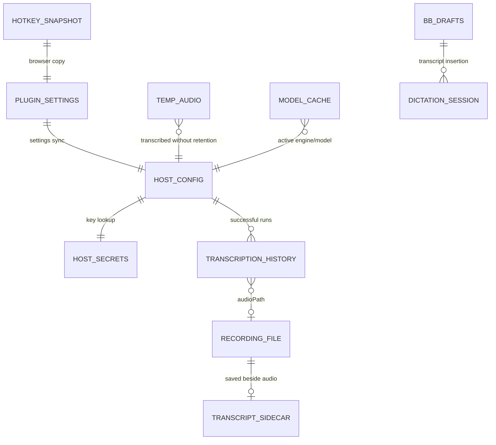

# Data model

TL;DR: The plugin stores settings in BB key-value storage and host files, secrets and media on the selected recognition host, model caches in the host user's home directory, and composer drafts in BB browser localStorage (`server.ts:160-169`, `src/paths.ts:8-21`, `src/frontend/global-voice-session.ts:77-102`).

## Schema overview

There is no SQL database or relational schema in this package. The diagram maps the persisted records and file collections owned or used by the plugin (`server.ts:160-169`, `src/paths.ts:8-21`, `src/frontend/global-voice-session.ts:456-508`).

The edges describe code relationships rather than database foreign keys: settings are synchronized by name/value mapping, history links to recordings through a path, and model activity is computed from current config (`server.ts:194-230`, `host.ts:231-251`, `host.ts:595-607`).

## Collections

### Plugin settings

**Purpose:** Persist non-secret user settings in the BB plugin key-value store under key `settings` (`server.ts:160-169`). The schema is strict and `mergeSettings` preserves valid known fields while filling defaults (`src/settings-store.ts:20-63`, `src/settings-store.ts:105-143`).

| Field | Meaning | Evidence |
|---|---|---|
| `uiLanguage` | UI dictionary key: `en`, `ru`, `de`, `fr`, `es`, `pt`, `zh`, or `ja` (`src/i18n/index.ts:13-33`). | `src/settings-store.ts:20-22` |
| `engine` | Engine ID: `whisper`, `gigaam`, `openai`, `google`, or `groq` (`src/contract.ts:8-9`). | `src/settings-store.ts:22-24` |
| `machine` | Empty for the BB server host, or a host ID/name used to route recognition (`src/settings-store.ts:24-30`). | `src/settings-store.ts:24-30` |
| `whisperModel` | Whisper model repository identifier; defaults to `mlx-community/whisper-large-v3-mlx-4bit`; allowed UI choices are in `WHISPER_MODELS` (`src/settings-store.ts:12-19`). | `src/settings-store.ts:30-31` |
| `language` | Recognition language: `auto`, `ru`, `en`, `de`, `fr`, `es`, `pt`, or `it` (`src/contract.ts:11-12`). | `src/settings-store.ts:30-32` |
| `vocabulary` | User text containing names/terms parsed by `parseVocabulary`. | `src/settings-store.ts:32-35`, `src/vocabulary.ts:14-36` |
| `vocabularyRepair` | Boolean enabling deterministic vocabulary-term repair. | `src/settings-store.ts:32-35`, `host.ts:198-205` |
| `vocabularyPrompt` | Boolean enabling vocabulary text as a recognition hint. | `src/settings-store.ts:32-35`, `host.ts:273-276` |
| `cleanupFillers` | Boolean enabling filler removal. | `src/settings-store.ts:34-36`, `host.ts:205-209` |
| `cleanupQuotes` | Boolean enabling language-specific quote cleanup. | `src/settings-store.ts:34-36`, `host.ts:205-209` |
| `openaiBaseUrl` | OpenAI-compatible transcription endpoint; defaults to `https://api.openai.com/v1`. | `src/settings-store.ts:37-40`, `src/settings-store.ts:78-81` |
| `openaiModel` | Transcription model; defaults to `gpt-4o-transcribe`. | `src/settings-store.ts:37-40`, `src/settings-store.ts:78-81` |
| `openaiKeyEnv` | Name of a host environment variable used for the OpenAI key. | `src/settings-store.ts:37-40`, `host.ts:96-101` |
| `openaiKeyCatalog` | Env Catalog variable name linked to the OpenAI key; empty means manual key source. | `src/settings-store.ts:37-40`, `server.ts:474-490` |
| `googleBaseUrl` | Google API endpoint; defaults to `https://generativelanguage.googleapis.com`. | `src/settings-store.ts:41-44`, `src/settings-store.ts:82-85` |
| `googleModel` | Google transcription model; defaults to `gemini-3.5-transcribe`. | `src/settings-store.ts:41-44`, `src/settings-store.ts:82-85` |
| `googleKeyEnv` | Name of a host environment variable used for the Google key. | `src/settings-store.ts:41-44`, `host.ts:96-101` |
| `googleKeyCatalog` | Env Catalog variable name linked to the Google key; empty means manual key source. | `src/settings-store.ts:41-44`, `server.ts:474-490` |
| `groqBaseUrl` | OpenAI-compatible Groq endpoint; defaults to `https://api.groq.com/openai/v1`. | `src/settings-store.ts:45-48`, `src/settings-store.ts:86-89` |
| `groqModel` | Groq transcription model; defaults to `whisper-large-v3-turbo`. | `src/settings-store.ts:45-48`, `src/settings-store.ts:86-89` |
| `groqKeyEnv` | Name of a host environment variable used for the Groq key. | `src/settings-store.ts:45-48`, `host.ts:96-101` |
| `groqKeyCatalog` | Env Catalog variable name linked to the Groq key; empty means manual key source. | `src/settings-store.ts:45-48`, `server.ts:474-490` |
| `aiPassEnabled` | Boolean enabling the optional text correction pass. | `src/settings-store.ts:49-53`, `host.ts:211-220` |
| `aiPassBaseUrl` | OpenAI-compatible text endpoint; defaults to `https://api.openai.com/v1`. | `src/settings-store.ts:49-53`, `src/settings-store.ts:90-94` |
| `aiPassModel` | Text model name; empty by default, so the pass is not configured. | `src/settings-store.ts:49-53`, `src/settings-store.ts:90-94` |
| `aiPassKeyEnv` | Name of a host environment variable used for the AI-pass key. | `src/settings-store.ts:49-53`, `host.ts:96-101` |
| `aiPassKeyCatalog` | Env Catalog variable name linked to the AI-pass key; empty means manual key source. | `src/settings-store.ts:49-53`, `server.ts:474-490` |
| `saveRecordings` | Boolean controlling retention of original audio files. Defaults to `true`. | `src/settings-store.ts:54-55`, `src/settings-store.ts:95-96`, `host.ts:402-411` |
| `keepDays` | Integer retention window in days, from 0 to 3650; zero disables cleanup. | `src/settings-store.ts:54-56`, `host.ts:176-190` |
| `hotkeyEnabled` | Boolean enabling the dictation hotkey; defaults to `true`. | `src/settings-store.ts:56-62`, `src/settings-store.ts:95-102` |
| `hotkeyCode` | Keyboard event code to match; defaults to `AltRight`. | `src/settings-store.ts:56-62`, `src/settings-store.ts:95-102` |
| `hotkeyAlt` | Boolean requiring Alt/Option modifier for non-modifier hotkeys. | `src/settings-store.ts:56-62`, `src/frontend/hotkey.ts:98-107` |
| `hotkeyCtrl` | Boolean requiring Control modifier for non-modifier hotkeys. | `src/settings-store.ts:56-62`, `src/frontend/hotkey.ts:98-107` |
| `hotkeyShift` | Boolean requiring Shift modifier for non-modifier hotkeys. | `src/settings-store.ts:56-62`, `src/frontend/hotkey.ts:98-107` |
| `hotkeyMeta` | Boolean requiring Meta/Command modifier for non-modifier hotkeys. | `src/settings-store.ts:56-62`, `src/frontend/hotkey.ts:98-107` |

**Keys and invariants:** The storage key is `settings`. Unknown keys are ignored; known keys are validated independently during reads and merged with defaults (`server.ts:160-169`, `src/settings-store.ts:113-143`). A patch with any invalid value returns an empty patch (`src/settings-store.ts:133-143`).

**Writers and readers:** The plugin server writes settings from page RPC and CLI config; server code reads them to construct host config and resolve machine selection (`server.ts:162-169`, `server.ts:474-493`, `server.ts:647-674`).

### Host configuration

**Purpose:** Hold the latest applied recognition config in `<host-data-dir>/config.json` (`src/paths.ts:8-21`). It contains recognition settings, provider endpoints/model names, secret placeholders, and retention switches as validated by `voiceConfigSchema` (`src/contract.ts:14-61`).

| Field | Meaning | Evidence |
|---|---|---|
| `engine`, `machine`, `whisperModel`, `language` | Selected engine, machine label, Whisper repository, and language setting. | `src/contract.ts:16-25` |
| `vocabulary`, `vocabularyRepair`, `vocabularyPrompt` | Vocabulary source and whether repair/prompting runs. | `src/contract.ts:26-29` |
| `cleanupFillers`, `cleanupQuotes` | Text cleanup options. | `src/contract.ts:29-30` |
| `cloud.openaiBaseUrl` | OpenAI-compatible endpoint for transcription. | `src/contract.ts:31-38` |
| `cloud.openaiModel` | OpenAI transcription model identifier. | `src/contract.ts:31-38` |
| `cloud.openaiApiKey` | Secret placeholder, overlaid from host secrets for use. | `src/contract.ts:31-38`, `host.ts:127-140` |
| `cloud.openaiKeyEnv` | Environment variable name resolved on the recognition host. | `src/contract.ts:31-38`, `host.ts:96-101` |
| `cloud.googleBaseUrl` | Google API endpoint. | `src/contract.ts:39-42` |
| `cloud.googleModel` | Google model identifier. | `src/contract.ts:39-42` |
| `cloud.googleApiKey` | Secret placeholder, overlaid from host secrets for use. | `src/contract.ts:39-42`, `host.ts:127-140` |
| `cloud.googleKeyEnv` | Environment variable name resolved on the recognition host. | `src/contract.ts:39-42`, `host.ts:96-101` |
| `cloud.groqBaseUrl` | OpenAI-compatible Groq endpoint. | `src/contract.ts:43-48` |
| `cloud.groqModel` | Groq transcription model identifier. | `src/contract.ts:43-48` |
| `cloud.groqApiKey` | Secret placeholder, overlaid from host secrets for use. | `src/contract.ts:43-48`, `host.ts:127-140` |
| `cloud.groqKeyEnv` | Environment variable name resolved on the recognition host. | `src/contract.ts:43-48`, `host.ts:96-101` |
| `aiPass.enabled` | Boolean enabling the second text pass. | `src/contract.ts:49-57` |
| `aiPass.baseUrl` | OpenAI-compatible endpoint for the text pass. | `src/contract.ts:49-57` |
| `aiPass.model` | Model identifier for the text pass. | `src/contract.ts:49-57` |
| `aiPass.apiKey` | Secret placeholder; actual key overlays from host secrets. | `src/contract.ts:49-57`, `host.ts:127-140` |
| `aiPass.keyEnv` | Host environment variable name for the text-pass key. | `src/contract.ts:49-57`, `host.ts:96-101` |
| `saveRecordings`, `keepDays` | Whether audio is retained and the recording age threshold. | `src/contract.ts:58-60` |

**Writers and readers:** `applyConfig` writes this file on connected hosts; transcription reads it and overlays separate secret values (`server.ts:238-255`, `host.ts:465-481`, `host.ts:103-140`). API key values are blanked when the server constructs this config (`server.ts:194-230`).

### Host secrets

**Purpose:** Store four provider secret values in `<host-data-dir>/secrets.json`: `openaiApiKey`, `googleApiKey`, `groqApiKey`, and `aiPassApiKey` (`src/secret-store.ts:11-13`, `src/paths.ts:11-12`).

| Field | Meaning | Evidence |
|---|---|---|
| `openaiApiKey` | OpenAI transcription credential. | `src/secret-store.ts:11-13`, `server.ts:41-46` |
| `googleApiKey` | Google transcription credential. | `src/secret-store.ts:11-13`, `server.ts:41-46` |
| `groqApiKey` | Groq transcription credential. | `src/secret-store.ts:11-13`, `server.ts:41-46` |
| `aiPassApiKey` | Optional AI text-pass credential. | `src/secret-store.ts:11-13`, `server.ts:41-46` |

Values are non-empty strings when present. Empty writes delete a key. The file is mode `0600` after each write (`src/secret-store.ts:15-34`, `src/secret-store.ts:36-53`). Plugin server methods write; host transcription and status methods read (`host.ts:438-455`, `host.ts:127-140`).

### Transcription history

**Purpose:** Append successful transcription records to `<host-data-dir>/history.jsonl` (`src/paths.ts:18-19`, `host.ts:231-251`).

| Field | Meaning | Evidence |
|---|---|---|
| `id` | Random UUID for the history record. | `src/contract.ts:77-87`, `host.ts:374-382` |
| `createdAt` | ISO timestamp created after successful recognition. | `src/contract.ts:79-81`, `host.ts:374-382` |
| `engine` | Engine ID used for this request. | `src/contract.ts:81-83`, `host.ts:367-382` |
| `durationMs` | Elapsed milliseconds measured inside `runTranscription`; not audio duration. | `src/contract.ts:81-83`, `host.ts:270-271`, `host.ts:367-382` |
| `audioPath` | Saved recording path or `null` if no retained file exists. | `src/contract.ts:82-84`, `host.ts:374-382` |
| `rawText` | Recognizer text before vocabulary repair, cleanup, and AI pass. | `src/contract.ts:83-86`, `host.ts:353-364` |
| `text` | Final returned text after post-processing. | `src/contract.ts:83-86`, `host.ts:363-382` |

**Lifecycle:** History is append-only in this code. It is written only after non-empty transcription succeeds; malformed JSONL lines are skipped on reads; the read method returns the latest requested records in reverse order (`host.ts:231-251`, `host.ts:363-384`, `host.ts:527-544`). No history cleanup job exists in the package.

### Recordings and transcript sidecars

**Purpose:** Store audio under `<host-data-dir>/recordings/YYYY-MM-DD/` using a UTC date and a time/UUID filename (`src/paths.ts:13-15`, `host.ts:162-174`).

| Data | Meaning | Evidence |
|---|---|---|
| Audio file | Original browser audio with MIME/name-derived extension. | `host.ts:153-174`, `host.ts:387-411` |
| Temporary audio file | When recording retention is off or saving the recording fails, the host writes the decoded audio under the host runtime's `tempDir` using a random UUID and derived extension. | `host.ts:387-411` |
| `<audio-path>.txt` | Final text written next to retained audio after successful transcription. | `host.ts:242-250` |
| Day directory | UTC date parsed by cleanup for age comparison. | `host.ts:162-169`, `host.ts:180-188` |

Retained recording files are attempted before transcription only when `saveRecordings` is true. If recording creation fails or retention is disabled, the host writes a temporary audio file and passes it to transcription; `audioPath` in history can then be null. Pruning runs after successful transcription and removes complete dated recording directories older than `keepDays`; zero disables that pruning (`host.ts:158-190`, `host.ts:374-384`, `host.ts:402-411`). The transcription handler contains no explicit deletion for the temporary audio file (`host.ts:387-430`).

### Model caches and engine runtime files

Model files use the recognition host user's Hugging Face or GigaAM cache, while environments, embedded Python assets, config, sockets, logs, history, and recordings are under the plugin host data directory (`src/model-store.ts:9-18`, `src/paths.ts:8-21`).

| File/collection | Meaning and lifecycle | Evidence |
|---|---|---|
| Whisper cache | Hugging Face repository directory derived from the configured model ID. | `src/model-store.ts:9-18`, `src/model-store.ts:48-61` |
| GigaAM cache | `<home>/.cache/gigaam`, listed as model `GigaAM v3`. | `src/model-store.ts:15-17`, `src/model-store.ts:64-72` |
| `venv-<engine>/` | One Python environment path per engine; local engines install their dependencies there. | `src/paths.ts:19-20`, `src/setup.ts:99-115` |
| `voiced-<engine>.sock`, `voiced-<engine>.log` | Per-engine local daemon socket and log paths. | `src/paths.ts:15-18` |
| `python/` | Materialized embedded engine and download scripts. | `src/paths.ts:13`, `scripts/embed-assets.mjs:8-29`, `host.ts:32-40` |

`downloadModel` and the Python download script write model data; `listModels` scans recognized Whisper/GigaAM cache directories and reports size/active state (`host.ts:568-607`, `src/model-store.ts:42-75`). Deleting a local model stops its daemon first; cloud engines have no model cache (`host.ts:568-593`, `host.ts:609-614`, `src/model-store.ts:10-18`).

### Browser composer drafts

**Purpose:** Reconcile transcript insertion with BB's own composer draft keys in browser `localStorage` (`src/frontend/global-voice-session.ts:77-102`). New-thread drafts use `bb.promptbox.contents-draft-3`; thread drafts use project/thread variants and an unscoped fallback key (`src/frontend/global-voice-session.ts:77-102`).

The draft object preserves `attachments` and optional `mentions`, updates `text`, dispatches a `storage` event, and inserts transcript text at the remembered caret where one is available (`src/frontend/global-voice-session.ts:456-508`, `src/frontend/composer-insert.ts:22-44`). BB's prompt box owns normal draft editing; the plugin reads/writes draft keys during dictation and does not synchronize them through plugin RPC (`src/frontend/global-voice-session.ts:456-508`).

### Browser hotkey snapshot

**Purpose:** Keep the hotkey configuration available to the browser interceptor through `localStorage` key `bb-plugin-voice-input.hotkey` (`src/frontend/hotkey.ts:4-5`, `src/frontend/hotkey.ts:272-287`).

| Field | Meaning | Evidence |
|---|---|---|
| `enabled` | Whether the published browser shortcut is active. | `src/frontend/hotkey.ts:9-16`, `src/frontend/hotkey.ts:272-287` |
| `code` | Keyboard event code for the trigger. | `src/frontend/hotkey.ts:9-16`, `src/frontend/hotkey.ts:272-287` |
| `alt`, `ctrl`, `shift`, `meta` | Required modifier flags. | `src/frontend/hotkey.ts:9-16`, `src/frontend/hotkey.ts:272-287` |

The settings page publishes this copy after loading or saving hotkey settings; the interceptor reads it and listens for the accompanying custom event (`app.tsx:456-460`, `app.tsx:482-497`, `src/frontend/hotkey.ts:272-287`). The BB plugin KV setting remains the settings source of truth (`server.ts:160-169`).

## Status transitions

| Field | From → to | Function and condition |
|---|---|---|
| Dictation session `state` | `idle → recording` | `GlobalVoiceSession.startRecording` after trigger; microphone failure returns to idle (`src/frontend/global-voice-session.ts:212-224`, `src/frontend/global-voice-session.ts:318-334`). |
| Dictation session `state` | `recording → transcribing` | `stopAndTranscribe` after a stop trigger (`src/frontend/global-voice-session.ts:338-348`). |
| Dictation session `state` | `transcribing → idle` | Result, empty audio, or failure (`src/frontend/global-voice-session.ts:373-377`, `src/frontend/global-voice-session.ts:436-452`). |
| Engine `detail` | `not-installed`, `needs-key`, `broken:<message>`, or `ready` | `engineReady` derives cloud state from key presence and local state from virtualenv/package import (`src/setup.ts:129-153`). |
| Model download `state` | `downloading → done` or `downloading → error` | Host emits progress/done/error events from the Python downloader (`src/contract.ts:212-225`, `host.ts:568-593`, `python/download.py:126-146`). |
| Model record `active` | `false ↔ true` | `listModels` computes it against the configured engine/model during each read (`host.ts:595-607`). |

## Invariants and ownership

- BB server settings own user choices; the recognition host owns runtime config and secret values (`server.ts:160-169`, `server.ts:194-230`, `src/paths.ts:8-21`).
- Secret values never travel in config pushed to hosts as ordinary settings; the server writes them through the `setSecret` method (`server.ts:194-230`, `server.ts:474-490`).
- History references an audio file by path only when one was retained; the history row does not embed audio bytes (`host.ts:231-251`, `host.ts:374-382`).
- Recording retention does not delete history JSONL entries or model caches (`host.ts:176-190`, `src/paths.ts:18-20`).

## Retention and cleanup

Successful transcription appends history and then prunes recording date directories. `keepDays <= 0` exits before scanning; positive values compare parsed directory dates with the millisecond threshold (`host.ts:176-190`, `host.ts:374-384`). The package contains no history compaction task. Model caches are removed only through the explicit delete-model operation (`host.ts:609-614`).

<!-- lane-pilot:backlinks -->
## Referenced by

- [Architecture](architecture.md)
- [BB Voice Input — Overview](overview.md)
